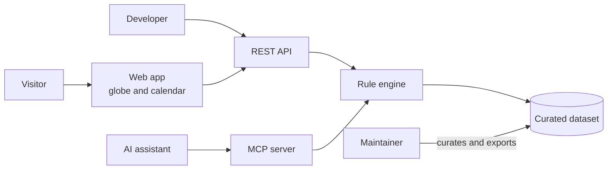

# Functional overview

[Documentation index](../README.md)

Holiday Atlas answers one question for 210 countries: which days are public holidays in a given year. It answers it in a web app for people, in a REST API for programs and in an MCP server for AI assistants.

## At a glance

| Topic | Summary |
|---|---|
| Product type | Public web app, REST API and MCP server |
| Users | Visitors who look up holidays, developers who integrate the API, AI assistants that query it |
| Coverage | 210 countries, 2,368 holiday rules, 181 of them regional |
| Years served | The current year and five years either side of it |
| Languages | English and French in the app. Holiday names in English, French and the country's own language |
| Accounts | None. The API is free and needs no key |
| Data source | A dataset curated by hand, with no third-party feed at run time |

## System context

## Problem

Public holidays differ from one country to the next, and many of them move every year. Easter-based holidays shift with the lunar cycle, some fall on the nth weekday of a month, and others follow the Hijri, Hebrew or Chinese calendar. A list of dates for one year is out of date twelve months later.

Holiday Atlas stores each holiday as a rule and computes the date for the year a client asks for. The same rule serves every year, so nothing has to be republished each January.

## Features

### Web app

| Feature | What it does |
|---|---|
| Globe | A rotating globe shows the covered countries. Selecting a country spins the globe to it and zooms in |
| Country search | Search by name or by country code. Each result shows the flag and the number of public holidays in the selected year |
| Year picker | Step through the eleven years the API serves, or pick one from a list |
| Calendar | Twelve month tiles with the holiday days marked. Opening a month lists its holidays |
| Holiday details | Name, date, description, and the regions that observe it when the holiday is regional |
| Regional holidays | A note says when a country has regional holidays. A setting hides them |
| Language and theme | English or French, light or dark. Both choices are remembered |
| For developers | A section links to the interactive API reference and offers the MCP connect command with a copy button |

### Public API

Two read-only routes return the covered countries and the holidays of one country for one year. See the [API reference](../02-technical/api-reference.md).

### MCP server

Three tools give an AI assistant the same data: list the countries, get a country's holidays for a year, and get a country's next holidays.

## Rules behind the dates

| Rule | Detail |
|---|---|
| Holidays are rules, not dates | Each holiday is stored once and resolved for the requested year |
| Fixed date | The same day every year. 1,802 rules |
| Easter-relative | An offset in days from Easter Sunday, Western or Orthodox. 173 rules |
| Nth weekday | For example the first Monday of September, or the last Monday of a month. 126 rules |
| Other calendars | A date on the Hijri, Hebrew or Chinese calendar, converted to the Gregorian year. 261 rules |
| Weekday near a date | The weekday before a date, or the weekday that falls between two dates. 6 rules |
| Estimated dates | Every Hijri date is flagged as estimated, because the observed date depends on a moon sighting and can differ by a day. 231 rules |
| Regional holidays | A holiday observed in part of a country lists those regions |
| Year window | A year outside the current year plus or minus five is refused |
| Exclusions | A holiday whose date cannot be computed reliably is left out of the dataset instead of being guessed |
| Unknown country | A country code with no data returns a clear not-found answer |

## Out of scope

- User accounts, API keys and paid plans.
- Holidays that span a whole week or have no date that can be computed.
- Years outside the eleven-year window.
