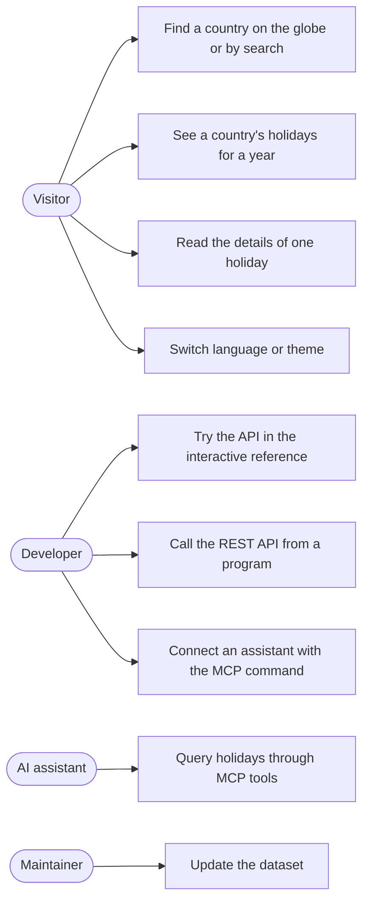
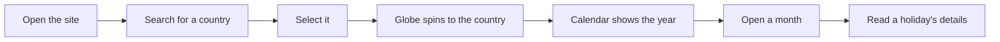
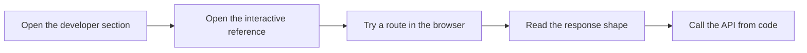
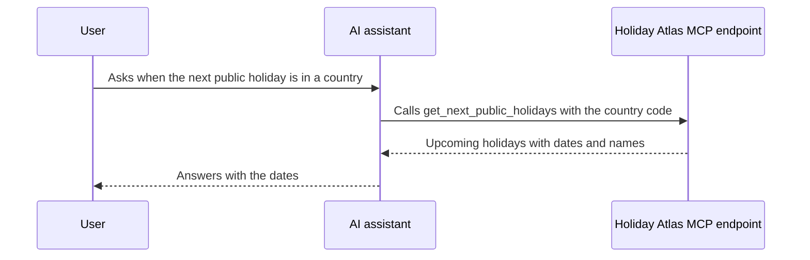

# Use cases

[Documentation index](../README.md)

This page lists who uses Holiday Atlas, what they come to do, and the paths they take.

## At a glance

| Topic | Summary |
|---|---|
| Human actors | Visitor, developer, maintainer |
| System actors | AI assistant connected through MCP |
| Entry points | Web app, REST API, MCP endpoint, interactive API reference |
| Verified by | End-to-end tests for every visitor flow, on four browser projects |

## Actors and use cases

## Use cases by actor

### Visitor

| Use case | Steps | Result |
|---|---|---|
| Find a country | Type a name or a country code in the search box. Arrow keys move through the matches and Enter selects | The globe spins to the country, and a panel shows its name and holiday count |
| See the year's holidays | Select a country | A calendar of twelve month tiles appears, with holiday days marked and a count per month |
| Change the year | Use the arrows or the year list | The calendar and the holiday counts in the search list follow the year |
| Open a month | Click a month tile | The month's holidays are listed next to the calendar |
| Read a holiday | Click a holiday card or a marked day | The details show the name, the date, the description and the regions when it is regional |
| Hide regional holidays | Open the calendar settings and use the switch | Regional holidays leave the calendar |
| Step back | Press Escape | The view steps back one level at a time |
| Switch language or theme | Use the toggles in the top bar | The page changes at once and keeps the choice on the next visit |

### Developer

| Use case | Steps | Result |
|---|---|---|
| Explore the API | Open the interactive reference from the site | Each route can be tried against the live API in the browser |
| List the countries | `GET /api/countries` | Every covered country with its holiday count for the year |
| Get a country's holidays | `GET /api/holidays` with a country code | That country's public holidays for the year |
| Connect an assistant | Copy the MCP command from the site | The assistant gains three holiday tools |

### AI assistant

| Use case | MCP tool |
|---|---|
| List the covered countries | `list_countries` |
| Get the holidays of a country and year | `get_public_holidays` |
| Get the next holidays of a country | `get_next_public_holidays` |

### Maintainer

| Use case | Steps | Result |
|---|---|---|
| Update the dataset | Edit the curated notes, run the export script, run the sanity check | A new dataset file and a coverage report that lists every excluded value and why |

## User journeys

### Looking up a country's holidays

### Integrating the API

### Asking an AI assistant

## Error cases the app handles

| Situation | What the visitor sees |
|---|---|
| The search has no match | A message says so |
| The country has no holidays in that year | A message says so |
| The API answers too many requests | A message explains the limit, with the waiting time when the API gives one |
| The API fails | An error panel with a Try again button |
| The address does not exist | A not-found page that links back home |

## Status and gaps

No user research has been carried out. The actors come from the purpose of the product.
