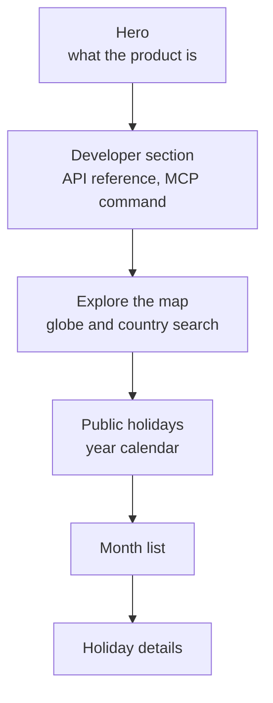
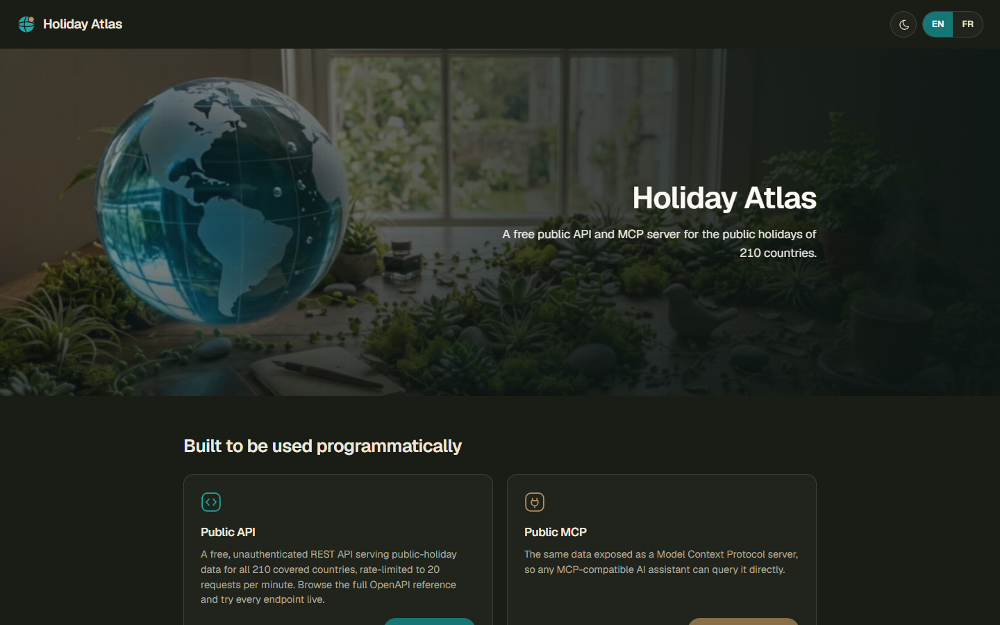
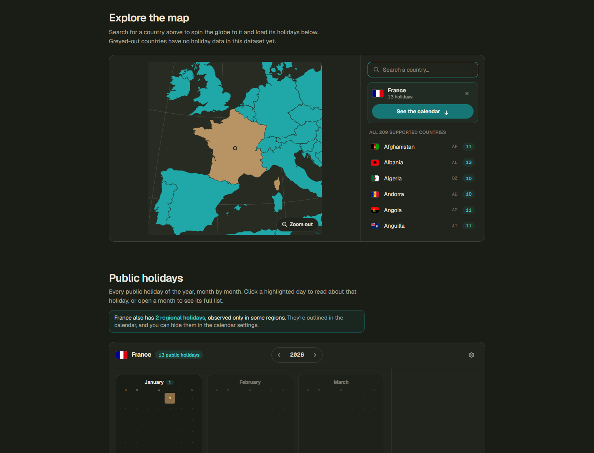
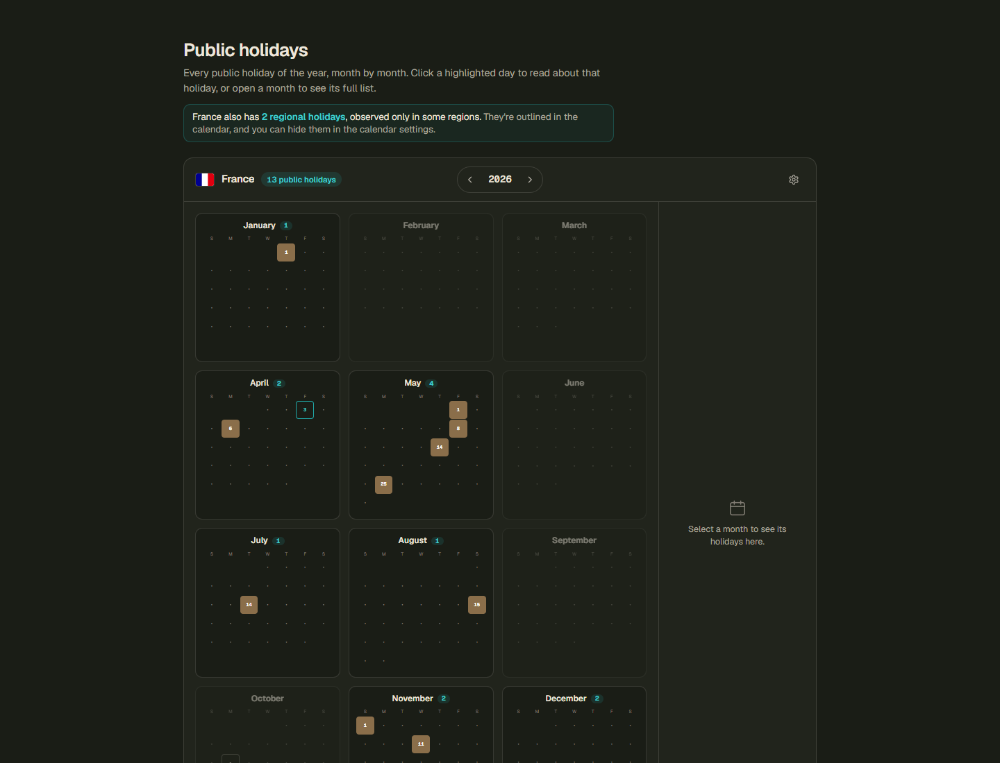
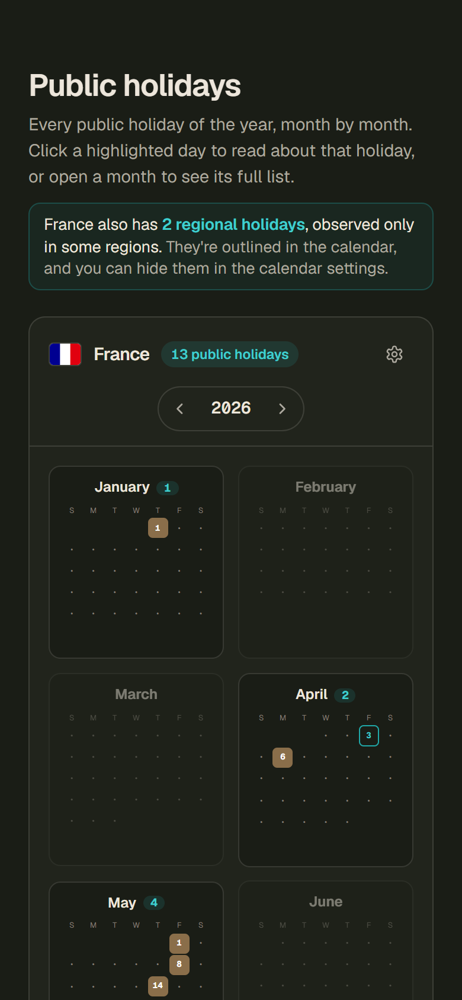

# UX design

[Documentation index](../README.md)

The web app is one page. A globe and a country search lead to a year calendar, and a section for developers leads to the API and the MCP server.

## At a glance

| Topic | Summary |
|---|---|
| Audiences | Visitors who look up holidays, developers who integrate the API |
| Page structure | Hero, developer section, globe with country search, year calendar, footer |
| Visual system | Design tokens as CSS custom properties, Tailwind CSS 4 theme, light and dark themes |
| Typography | Geist Sans and Geist Mono, hosted with the site |
| Layout | Responsive, checked on desktop browsers and a phone viewport |
| Languages | English and French |
| Accessibility target | WCAG 2.1 AA, scanned automatically in both themes |

## Page flow

## Audiences

| | Visitor | Developer |
|---|---|---|
| Comes to | Find the public holidays of a country for a year | Decide whether the API or the MCP server fits their project |
| First action | Search for a country or turn the globe | Open the interactive API reference or copy the MCP command |
| Needs | Dates that are right for the chosen year, and a clear signal when a date is an estimate or regional | Response shapes, error codes and limits without reading source code |

The audiences come from the purpose of the product. No user research has been carried out.

## Design principles

- One page, top to bottom. The visitor never leaves the page to get from a country to a holiday.
- The globe is the navigation. Selecting a country in the list and seeing the globe travel to it ties the list to the map.
- Honest data. An estimated date is flagged, a regional holiday is outlined, and a country without data is greyed out.
- Stable layout. The calendar keeps its size and position while a year loads.
- Keyboard first in the search. Arrow keys, Enter and Escape cover the whole flow.

## Design tokens

Tokens are CSS custom properties. Tailwind CSS reads them through its theme, so components use token names and never raw values. The dark theme redefines the same tokens.

### Colour

| Token | Role | Light | Dark |
|---|---|---|---|
| `--ha-bg` | Page background | `#faf9f6` | `#1a1d16` |
| `--ha-card` | Card surface | `#ffffff` | `#21241c` |
| `--ha-fg` | Text | `#3d342a` | `#ede6db` |
| `--ha-muted` | Secondary text | `#6d665e` | `#ada99f` |
| `--ha-teal` | Covered countries, selection, links | `#1da4a4` | `#20a8a8` |
| `--ha-amber` | Selected country and holiday days | `#598e53` | `#b89363` |
| `--ha-unsupported` | Countries without data | `#dedcd6` | `#333730` |
| `--ha-chip` | Count chips | `#eef1ea` | `#272b21` |

### Type and shape

| Token | Size | Used for |
|---|---|---|
| Display | 44 px | Hero headline |
| Headline | 26 px | Section headings |
| Body large | 17 px | Hero lead paragraph |
| Body | 14.5 px | Explanations and status text |
| Label | 13 px | Pills, legend, footer chips |
| Caption | 12 px | Month labels, footer details |

Corner radii follow a four-step scale: 4, 8, 10 and 14 px.

## Screens

### Hero and developer section

### Globe and country search

### Year calendar

### Calendar on a phone

## Interface states

| State | Behaviour |
|---|---|
| No country selected | The calendar area shows a prompt to pick a country |
| Loading a year | The calendar keeps its size and position, and is marked busy for assistive technology |
| Month without holidays | The tile is dimmed and cannot be opened |
| Search without a match | A message says so |
| Country with regional holidays | A note above the calendar gives the count and points to the setting that hides them |
| API error | An error panel with a Try again button |
| Too many requests | A message explains the limit and the waiting time |
| Country without data | Greyed out on the globe and absent from the search list |

## Accessibility in the design

- The search is a combobox with options, usable with the keyboard alone.
- A whole month tile is clickable, and its name is the keyboard control. Interactive elements are not nested.
- Text contrast meets WCAG 2.1 AA in both themes.
- The setting for regional holidays is a switch with a label.
- The page language attribute follows the selected language.
- The theme follows the system preference on a first visit, and a toggle overrides it.

[Audit](../03-quality/audit.md) reports the automated accessibility results.

## Design decisions

| Decision | Reason |
|---|---|
| A globe that travels to the selected country | The movement shows where the country is. Countries that are hard to click stay reachable through the search |
| Country search next to the globe | A country that is hard to click on a globe is one keystroke away |
| Month tiles first, details on request | Twelve tiles show the shape of the whole year at a glance. Opening a month or a day gives the detail |
| Estimated dates flagged | A Hijri date can move by a day, and the app says so |
| Regional holidays outlined and optional | A visitor in one region does not mistake a regional holiday for a national one |
| Language toggle in the browser, with no separate address per language | The site stays a single static page. A returning French visitor sees English for an instant before the saved language applies |
| Theme chosen before the page renders | The page does not flash the wrong theme while loading |
| Fonts and API reference assets hosted with the site | The page makes no request to a third party at run time |
| Developer section above the map | The product is an API first, and the web app demonstrates it |

## Status and gaps

| Item | Status on 2026-10-12 |
|---|---|
| User research and usability tests | Not carried out |
| Manual review with a screen reader | Planned |
