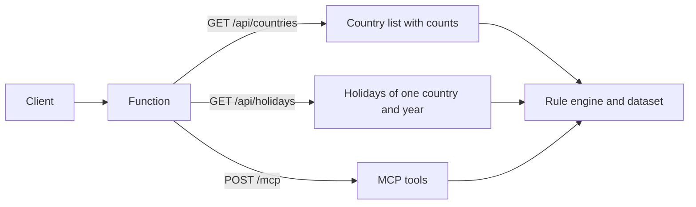

# API reference

[Documentation index](../README.md)

Holiday Atlas has a free, public, read-only REST API and an MCP endpoint. This page summarizes both. The interactive reference on the site lets you try each route in the browser.

## At a glance

| Topic | Summary |
|---|---|
| Base URL | `https://p4c6e4mu4k5sg4fwnertd2zgwi0hordn.lambda-url.eu-north-1.on.aws` |
| Style | REST, JSON |
| Authentication | None |
| Cross-origin calls | Allowed from any origin |
| Rate limit | 20 requests per minute per IP address |
| Years served | The current year and five years either side of it |
| MCP | Three read-only tools at `/mcp` |
| Interactive reference | [holiday-atlas.rafikadiche.com/docs.html](https://holiday-atlas.rafikadiche.com/docs.html) |
| OpenAPI 3 specification | [holiday-atlas.rafikadiche.com/openapi.json](https://holiday-atlas.rafikadiche.com/openapi.json) |

## Request flow



## REST routes

| Method | Path | Description |
|---|---|---|
| GET | `/api/countries?year={year}` | Every country with data, and each country's number of public holidays for the year |
| GET | `/api/holidays?countryCode={code}&year={year}` | The public holidays of one country for the year |

| Parameter | Required | Description |
|---|---|---|
| `countryCode` | Yes, on `/api/holidays` | ISO 3166-1 alpha-2 code, such as `FR`. Case does not matter |
| `year` | No | Defaults to the current year. Must fall within five years either side of it |

Example:

```bash
curl "https://p4c6e4mu4k5sg4fwnertd2zgwi0hordn.lambda-url.eu-north-1.on.aws/api/holidays?countryCode=FR&year=2026"
```

### Country

| Field | Type | Description |
|---|---|---|
| `countryCode` | string | ISO 3166-1 alpha-2 code |
| `name` | string | Country name in English |
| `holidayCount` | integer | Number of public holidays in the requested year |

### Holiday

| Field | Type | Description |
|---|---|---|
| `date` | string | ISO 8601 date in the requested year |
| `title` | object | The name in French (`fr`), in English (`en`) and in the country's own language (`original`) |
| `description` | object | A short description in French (`fr`) and English (`en`) |
| `countryCode` | string | ISO 3166-1 alpha-2 code |
| `fixed` | boolean | Whether the holiday falls on the same date every year |
| `global` | boolean | Whether the holiday is observed in the whole country |
| `counties` | array | The regions that observe it, when the holiday is regional |
| `estimated` | boolean | Present and true when the date depends on a moon sighting and can differ by a day |

## Errors

Errors are JSON objects with a single `error` message.

| Status | Meaning |
|---|---|
| `400` | A missing country code, or a year outside the served window |
| `404` | No data for that country code |
| `429` | Too many requests. The `Retry-After` header gives the number of seconds to wait |
| `500` | Unexpected error |
| `502` | Reserved for a data source failure. Not expected, because the dataset ships with the function |

## MCP tools

The MCP endpoint answers JSON-RPC requests at `POST /mcp`.

| Tool | Parameters | Description |
|---|---|---|
| `list_countries` | `year?` | The countries with data, with holiday counts for the year |
| `get_public_holidays` | `countryCode`, `year?` | The public holidays of a country for a year |
| `get_next_public_holidays` | `countryCode` | The next upcoming public holidays of a country |

### Connecting a client

With Claude Code:

```bash
claude mcp add --transport http holiday-atlas https://p4c6e4mu4k5sg4fwnertd2zgwi0hordn.lambda-url.eu-north-1.on.aws/mcp
```

The site has the same command with a copy button.

## Stability

The address above is the API's current public address. The OpenAPI specification on the site lists the same address.
