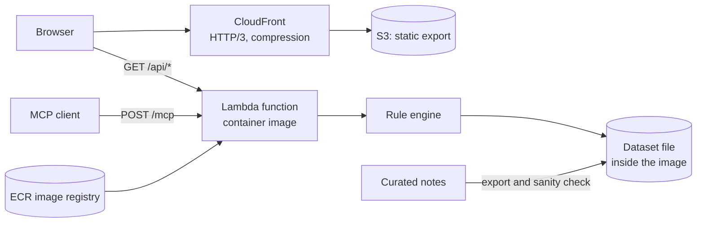
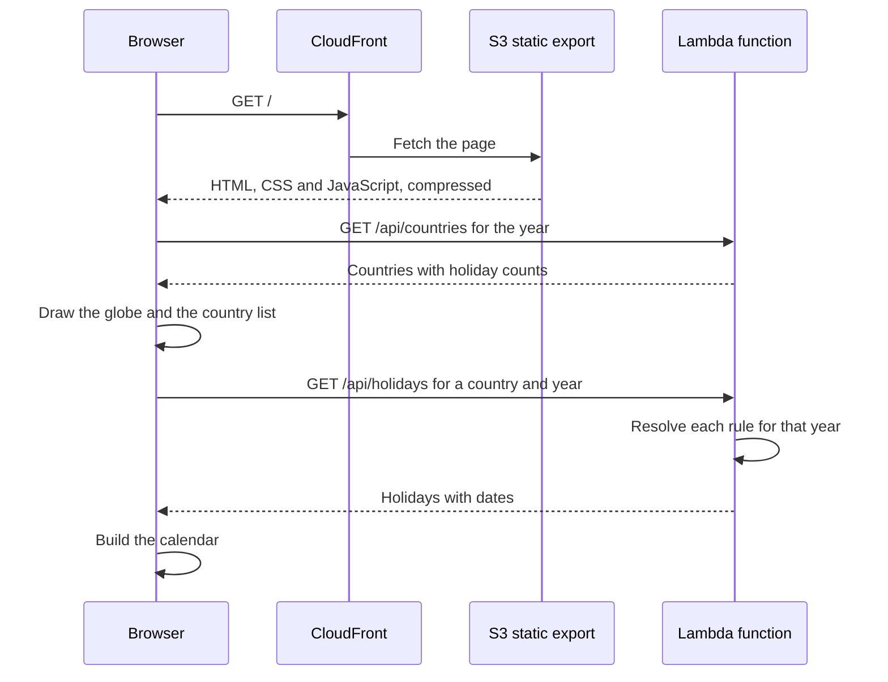

# Architecture

[Documentation index](../README.md)

Holiday Atlas is a static site and one serverless function. The function holds the whole dataset and computes holiday dates on request, so the system has no database and no call to another service at run time.

## At a glance

| Topic | Summary |
|---|---|
| Style | Static frontend, single serverless function, data shipped with the code |
| Patterns | Rules resolved at request time, static export, offline data pipeline, infrastructure as code |
| Hosting | AWS: CloudFront, S3, Lambda with a function URL, ECR |
| Languages | TypeScript for the frontend and backend, HCL for Terraform |
| Protocols | HTTPS, REST with JSON, MCP over JSON-RPC |
| Environments | Local development and production |

## Containers

## How a calendar gets its data

The site and the API have different addresses. The browser calls the API across origins, and the API allows it.

## What is computed where

| Work | Where | When |
|---|---|---|
| Turning curated notes into rules | Export script | When the dataset changes |
| Checking the dataset against known dates | Sanity check script | After each export |
| Turning a rule into a date for a year | Function | On each request |
| Where the globe flies for each country, and the size of each landmass | Build step, saved as a file | When the map data changes |
| Month grids, search matching, text in the selected language | Browser | On each interaction |

## Technical decisions

| Decision | Reason | Consequence |
|---|---|---|
| Store holidays as rules and compute dates per year | A list of dates is out of date a year later | The same dataset serves every year. The rule engine needs careful checks |
| Ship the dataset inside the function | The data changes rarely and fits in memory | No database to run or pay for. A data change needs a new deploy |
| No third-party holiday feed at run time | The data stays available and consistent whatever happens upstream | The dataset is curated by hand |
| Use the runtime's built-in calendar support for the Hijri, Hebrew and Chinese calendars | It avoids writing astronomical algorithms by hand | Results follow the runtime's calendar data. Hijri dates are flagged as estimated |
| A small MCP handler written for the function, with a full MCP server for local development | A function invocation is short-lived, and the server library expects a long-lived process | The function supports the two MCP methods the tools need |
| One function for the REST routes and the MCP endpoint | Both read the same rules through the same code | One deploy, one set of limits |
| Static export for the frontend | There is no server to run or pay for | Everything dynamic happens in the browser |
| Rate limit inside the function, per client address | No extra service is needed | A client over the limit gets a clear answer with a waiting time |
| Precompute the globe's geometry at build time | Computing it in the browser blocked the page for about two seconds | A unit test fails when the saved file no longer matches the map data |
| A size budget for first-load JavaScript in continuous integration | A regression is caught before it ships | A build over the budget fails |

## Status and gaps

- There is no staging environment. Changes go from local development to production.
- The backend and the infrastructure are deployed by hand. See [Operations](../03-quality/operations.md).
