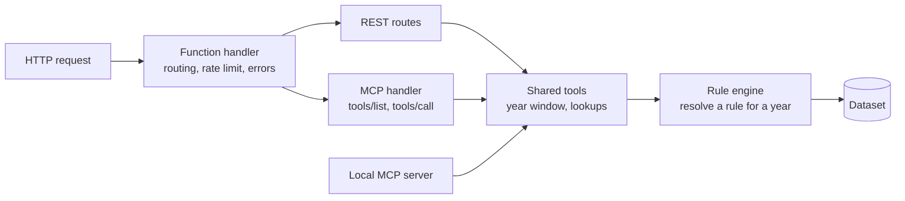
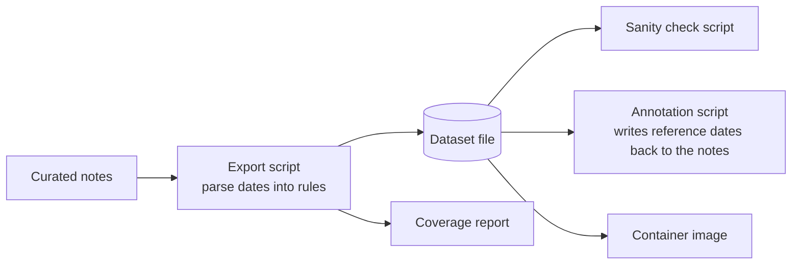

# Backend

[Documentation index](../README.md)

The backend is one AWS Lambda function written in TypeScript. It serves two REST routes and an MCP endpoint from a dataset of holiday rules that ships inside the function, and it computes the dates for the requested year on each call.

## At a glance

| Topic | Summary |
|---|---|
| Language and runtime | TypeScript 5 in strict mode, Node.js 20 on AWS Lambda |
| Packaging | Container image |
| API | REST with JSON, documented with OpenAPI 3 |
| MCP | Model Context Protocol tools over JSON-RPC, with a FastMCP server for local development |
| Validation | zod schemas for MCP tool parameters, explicit checks on REST parameters |
| Data | Static JSON dataset: 210 countries, 2,368 rules |
| Calendars | Gregorian, Easter (Western and Orthodox), Hijri, Hebrew, Chinese |
| Tooling | Export, annotation and sanity check scripts run with tsx |

## Modules

| Module | Role |
|---|---|
| Function handler | Routes requests, applies the rate limit, shapes errors |
| MCP handler | Answers the tool listing and tool calls |
| Local MCP server | A full MCP server over HTTP streaming, used in development |
| Shared tools | The three operations both entry points expose, and the year window |
| Rule engine | Rule types and the date arithmetic that resolves them |
| Dataset access | Country list, holidays of a year, next holidays |

The production handler and the local server share the same tools module, so the two cannot drift apart in behaviour.

## Rule engine

A holiday is one of six kinds of rule.

| Kind | Example | Rules in the dataset |
|---|---|---|
| Fixed date | 14 July | 1,802 |
| Easter-relative | 39 days after Easter Sunday, Western or Orthodox | 173 |
| Nth weekday of a month | Fourth Thursday of November | 126 |
| Date on another calendar | A day of a Hijri, Hebrew or Chinese month | 261 |
| Weekday between two dates | The Saturday that falls inside a date range | 4 |
| Weekday before a date | The Monday before 25 May | 2 |

Of the 261 calendar rules, 231 use the Hijri calendar, 19 the Chinese calendar and 11 the Hebrew calendar.

Easter is computed with the standard algorithms for the Western and the Orthodox date. Dates on the Hijri, Hebrew and Chinese calendars are converted with the calendar support built into the runtime. Every Hijri result is marked `estimated`, because the observed date depends on a moon sighting.

A rule resolves to several dates when a holiday spans consecutive days, such as the first three days of a Hijri month. A rule that does not occur in the requested year resolves to nothing.

## Dataset pipeline

- The source is a set of 2,533 hand-curated notes. Each holiday's date is written there as a rule.
- The export script parses each date into a rule and writes the dataset. It prints a coverage report: totals by kind of rule, the number of estimated dates, every excluded value with the reason, and any country left with no holiday.
- A date that matches no rule is excluded. The script does not guess.
- The sanity check verifies the shape of the data and compares resolved dates with known ones for a reference year, such as Easter, Eid al-Fitr, Rosh Hashanah, Chinese New Year and Thanksgiving. It also resolves all 210 countries for a year and fails on any error.
- The annotation script writes a computed reference date back into each note with the same rule engine, so the notes and the API cannot disagree.

The dataset file is committed. A change to the notes becomes a reviewed change to that file.

## Request handling

- The year is optional and defaults to the current year. A year outside the current year plus or minus five returns `400`.
- A country code is matched without regard to case. An unknown code returns `404`.
- Requests are rate limited per client address. A client over the limit gets `429` with a `Retry-After` header.
- Errors are JSON objects with one `error` message.

The [API reference](api-reference.md) lists the routes and tools.

## Status and gaps

| Item | Status on 2026-10-12 |
|---|---|
| TypeScript strict check | Passes |
| Sanity check script | Passes |
| Unit test suite | Planned. The sanity check covers the data and the calendar arithmetic today |
| Linting | Planned |
| Continuous integration and automated deploy | Planned. The image is built and pushed by hand |
