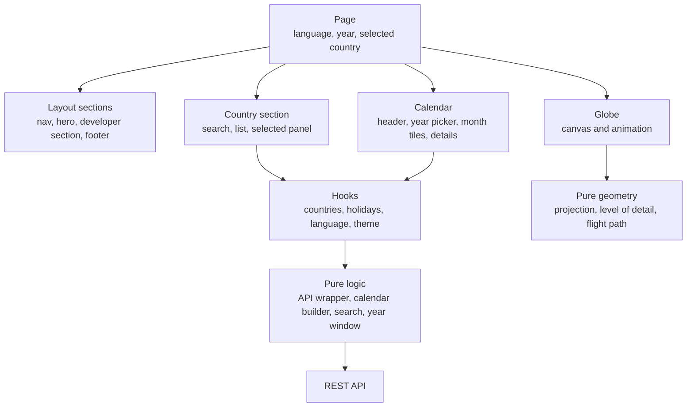

# Frontend

[Documentation index](../README.md)

The frontend is a one-page Next.js application exported as static files. It draws a globe on a canvas, loads holiday data from the API in the browser, and runs no server in production.

## At a glance

| Topic | Summary |
|---|---|
| Framework | Next.js 16 with the App Router, static export |
| UI library | React 19 |
| Language | TypeScript 5 in strict mode |
| Styling | Tailwind CSS 4, design tokens as CSS custom properties |
| Globe | HTML canvas with d3-geo, d3-ease, topojson-client and versor, map data from world-atlas |
| State | React state and custom hooks, browser local storage for language and theme |
| Internationalization | English and French, one typed file per language |
| Testing | Vitest, React Testing Library, Playwright, axe-core |
| Code quality | ESLint 9 with a 300-line limit per file, TypeScript compiler checks |
| Hosting | Static files on Amazon S3 behind Amazon CloudFront |

## Structure

| Layer | Content |
|---|---|
| Page | Owns what the sections share: language, year and selected country |
| Components | Layout, country, globe, calendar and small shared pieces |
| Hooks | State with behaviour: language, theme, the two API requests, what is open in the calendar |
| Pure logic | The API wrapper, the calendar builder, search, the year window, country and holiday text |
| Translations | One file per language. French is typed against English, so a missing key does not compile |

Three rules shape the code. No source file is longer than 300 lines, and ESLint enforces it. Logic that can be a pure function is one, with a unit test next to it. Translations travel as props.

## Data loading

Two hooks own the two API requests: the countries for a year, and the holidays of a country for a year. Components read their result and never call the API themselves.

One module wraps every API call and sorts failures into five kinds: forbidden, not found, rate limited, server error and network error. Each kind has its own message in both languages. Next.js error and not-found boundaries cover everything outside the API layer.

## The globe

The globe is the largest part of the site's JavaScript, so it loads in steps.

| Step | What loads | When |
|---|---|---|
| 1 | The page: hero, search, calendar | First, so the page is readable at once |
| 2 | The globe code with coarse country outlines | Right after, as its own chunk |
| 3 | Detailed country outlines | When the browser is idle, or when a country is selected |

The expensive geometry is computed at build time and saved as a file: where the globe flies for each country, and a circle around each landmass that lets the drawing code skip what is off screen. A unit test fails when that file no longer matches the map data.

The drawing code is split into pure modules for projection, level of detail and flight path, plus one module that paints a frame. The pure modules are covered by unit tests with a coverage threshold.

## Performance budget

A file in the repository caps the compressed JavaScript the page loads up front. Continuous integration measures the build and fails when it goes over.

| Measure | Value |
|---|---|
| First-load JavaScript measured in CI on 2026-10-12 | 205.2 kB gzip in 11 scripts |
| Budget | 226 kB gzip |
| Before the rewrite | 887 kB gzip |

[Audit](../03-quality/audit.md) has the full before and after figures.

## Theming and layout

Colours, type sizes and corner radii are design tokens defined once as CSS custom properties and exposed to Tailwind CSS through its theme. The dark theme redefines the colour tokens. A short inline script picks the theme before the page renders, from the visitor's saved choice or the system preference.

Fonts are downloaded at build time and served with the site, so the page makes no font request to a third party and text does not shift when the font arrives.

[UX design](../01-functional/ux-design.md) lists the tokens.

## Interactive API reference

The site ships a self-contained Swagger UI page and a hand-written OpenAPI 3 specification. Its assets are stored with the site instead of being loaded from a CDN. The "try it out" feature calls the live API.

## Build and delivery

`next build` writes the static site to a folder. Continuous integration tests those exact files, uploads them to a private S3 bucket and invalidates the CDN cache. Browser cache lifetimes are set per kind of file: a year for hashed build assets, a day for other assets, none for pages.

## Status and gaps

| Item | Status on 2026-10-12 |
|---|---|
| ESLint and TypeScript strict check | Pass in continuous integration |
| Unit and component tests | 137 tests in 16 files, all passing |
| End-to-end tests | Pass on Chromium, Firefox, WebKit and a phone viewport |
| Bundle size budget | Within budget |
| Automated deploy from the main branch | Workflow in place. The first automated deploy is pending |
