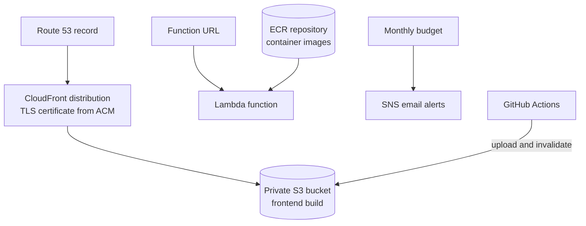
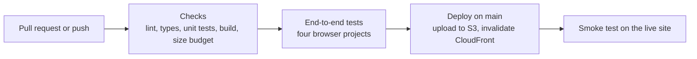

# Infrastructure

[Documentation index](../README.md)

Everything runs on AWS and is described in one Terraform module. CloudFront serves the static site from a private S3 bucket, and a Lambda function behind a function URL serves the API.

## At a glance

| Topic | Summary |
|---|---|
| Infrastructure as code | Terraform with the AWS provider, remote state, one root module |
| Edge | Amazon CloudFront with HTTP/3 and compression, AWS Certificate Manager, Amazon Route 53 |
| Static hosting | Amazon S3, private, reached only through CloudFront |
| API | AWS Lambda from a container image, public function URL |
| Image registry | Amazon ECR with scanning on push and a lifecycle policy |
| Identity | AWS IAM: a function role and a scoped deploy identity |
| Cost | AWS Budgets with email alerts through Amazon SNS |
| Tooling | Terraform and the AWS CLI run in Docker |
| CI/CD | GitHub Actions for the frontend |
| Environments | Local development and production |

## Deployment view

## Patterns

### Static site

- The bucket blocks all public access. CloudFront reads it through origin access control.
- HTTP requests are redirected to HTTPS, and the distribution accepts TLS 1.2 or later.
- The distribution serves HTTP/2 and HTTP/3 and compresses text assets at the edge.
- Browser cache lifetimes are set at upload: long for hashed build assets, none for pages.

### API

- The function runs from a container image, so the same image is built and tested locally before it reaches AWS.
- The function URL is public by design. The API is free and needs no key.
- Cross-origin rules are defined in one place, on the function URL.
- The image registry scans each pushed image and keeps only recent ones.

### Identity

- The function has its own execution role.
- Deploys use a separate identity that can only upload to this project's bucket, invalidate its distribution, push to its image registry and update its function.
- The person who applies Terraform uses different credentials from the deploy identity.

### Terraform practice

- One flat root module covers the whole project.
- State is remote, under a key of its own.
- The provider lock file is committed, so every run resolves the same provider version.
- Terraform runs inside a container, so no tool version depends on the host machine.
- The configuration can be validated without AWS credentials.
- A plan is saved to a file and read in full before it is applied.

## Cost control

- The site is static and the API is a single function, so there is no always-on compute and no database.
- A monthly budget sends email alerts before and when the limit is reached.

## CI/CD

This pipeline belongs to the frontend. The backend image and the Terraform changes are applied by hand.

## Status and gaps

| Item | Status on 2026-10-12 |
|---|---|
| Frontend pipeline | Checks and end-to-end tests run on every push. The first automated deploy is pending |
| Backend deploy | By hand. Automation planned |
| Infrastructure changes | Applied by hand. Continuous integration planned |
| Staging environment | Not present |
| Monitoring beyond the budget alert | Planned |
