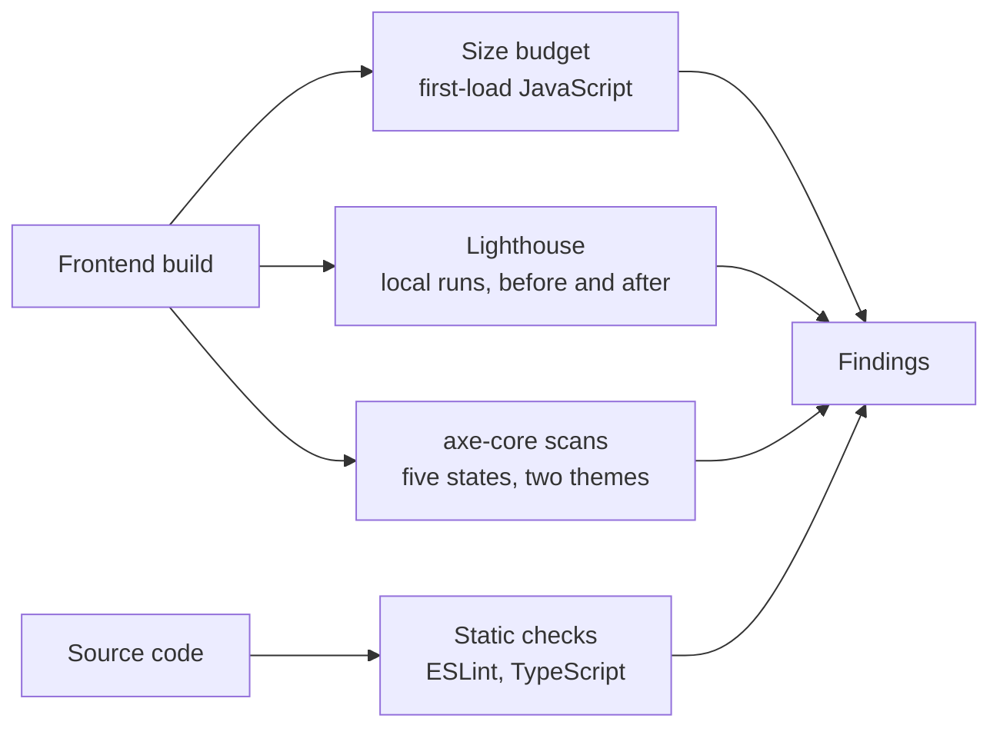

# Audit

[Documentation index](../README.md)

This page records the measured quality of the application: performance, accessibility and code quality. Every result has the date it was taken and says where it was measured.

## At a glance

| Topic | Summary |
|---|---|
| Performance | Lighthouse 13, a first-load JavaScript budget in continuous integration, main-thread task timing |
| Accessibility | axe-core scans against WCAG 2.1 A and AA in both themes, on four browser projects |
| Code quality | ESLint with a file length limit, TypeScript strict mode |
| Audit dates | 2026-10-11 and 2026-10-12 |

## What is audited and how

## Performance

The frontend was rewritten in October 2026 to load faster with no visible change. The figures below compare the build before and after that work.

### JavaScript size

Measured by continuous integration on 2026-10-12.

| Measure | Before | After |
|---|---|---|
| First-load JavaScript, gzip | 887.0 kB | 205.2 kB |
| First-load JavaScript, raw | 2,786 kB | 660 kB |
| Loaded later, on demand | Nothing | Globe 78.2 kB gzip, detailed outlines 233.0 kB gzip |

The budget in continuous integration is 226 kB. A build over it fails.

### Startup work on the main thread

Measured locally on 2026-10-12 in headless Chromium.

| Measure | Before | After |
|---|---|---|
| Longest task, desktop CPU | 703 ms | 100 to 106 ms |
| Longest task, CPU slowed four times | 5,221 ms | 279 to 422 ms |
| First paint, desktop CPU | 740 ms | 152 ms |

### Lighthouse, local runs

Measured locally on 2026-10-12: median of three runs with simulated throttling, both builds served from the same machine. The runs show what the code change did. They are not measurements of the live site, and the absolute values on that machine are pessimistic.

| Metric | Mobile before | Mobile after | Desktop before | Desktop after |
|---|---|---|---|---|
| Performance score | 42 | 62 | 68 | 99 |
| Largest Contentful Paint | 10.8 s | 5.2 s | 2.1 s | 0.9 s |
| Total Blocking Time | 2,711 ms | 646 ms | 509 ms | 74 ms |
| Cumulative Layout Shift | 0 | 0 | 0 | 0 |
| Speed Index | 5.2 s | 4.1 s | 0.8 s | 0.6 s |

### Delivery

Measured on the live site on 2026-10-11, after compression and HTTP/3 were enabled at the edge and before the code changes.

| Measure | Before | After |
|---|---|---|
| Total transfer, mobile | 4,011 kB | 1,901 kB |
| Total transfer, desktop | 4,194 kB | 1,928 kB |
| Script transfer | 2.7 MB | under 1 MB |

### Findings

- First-load JavaScript is down by 77%, and the one long freeze at startup is gone.
- Desktop performance reaches 99 in local runs.
- Mobile performance is 62 in local runs. Blocking time on a slowed CPU is still above the 200 ms target.
- Layout shift is zero in every run.

## Accessibility

Continuous integration runs an axe-core scan with the WCAG 2.1 A and AA rule sets on five states of the page, in the light and the dark theme, on each of the four browser projects. A state must report zero violations, and no rule is exempted.

| State scanned | Result on 2026-10-12 |
|---|---|
| Initial page | No violations |
| Country selected | No violations |
| Month open | No violations |
| Holiday details open | No violations |
| Calendar settings open | No violations |

Two findings from earlier scans were fixed on 2026-10-12: text contrast was raised to the AA ratio, and month tiles no longer nest one button inside another.

Automated checks cover only part of WCAG 2.1 AA. [UX design](../01-functional/ux-design.md) lists the design measures the checks cannot score.

## Code quality

| Repository | ESLint | TypeScript strict check | Other |
|---|---|---|---|
| `frontend` | Passes in continuous integration | Passes | No source file over 300 lines, enforced by ESLint |
| `backend` | Planned | Passes | Sanity check script passes |

Before the rewrite, the frontend had three files of 650 to 700 lines and no tests.

## Status and gaps

| Item | Status on 2026-10-12 |
|---|---|
| Lighthouse on the live site with the rewritten frontend | Planned, after the first automated deploy |
| Mobile blocking time | Above target. Improvement planned |
| Manual accessibility review with a keyboard and a screen reader | Planned |
| Linting for the backend | Planned |
