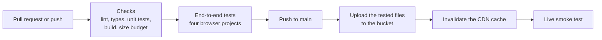
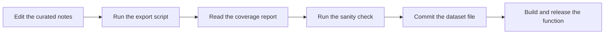

# Operations

[Documentation index](../README.md)

This page covers how the running application is checked and how changes reach production: health checks, deployment, data updates and recovery.

## At a glance

| Topic | Summary |
|---|---|
| Health check | A live smoke test of the site and the API, run by the deploy pipeline |
| Frontend deployment | GitHub Actions: checks, end-to-end tests, upload, cache invalidation, smoke test |
| Backend deployment | Container image built, pushed and released by hand |
| Infrastructure changes | Terraform plan read in full, then applied by hand |
| Data updates | Export script, sanity check, reviewed change to the dataset file |
| Alerting | Monthly budget alerts by email |
| Recovery | Redeploy an earlier build or image from version control and the registry |

## Health check

The health of the application is checked from the outside, the way a visitor uses it. Two tests run against the deployed site:

| Test | What it proves |
|---|---|
| Load the site, select a country, find a known holiday | The static site is served, the API answers, and the two work together |
| Compare a live API answer with the recorded format | The API still returns the fields the frontend expects |

The same suite can be run by hand at any time.

The API can also be probed directly. `GET /api/countries` answers `200` with the country list when the function and its dataset are healthy.

Checked on 2026-10-12: the site was served compressed and offered HTTP/3, `/api/countries` returned 210 countries, and the MCP endpoint listed its three tools.

## From commit to production

| Repository | How it deploys |
|---|---|
| `frontend` | Through GitHub Actions on every push to the main branch. The pipeline uploads the same files the tests ran against |
| `backend` | By hand: build the container image, test it locally, push it to the registry, point the function at it |
| `infrastructure` | By hand: `terraform plan` saved to a file, read in full, then applied |

The frontend upload sets a browser cache lifetime per kind of file, then invalidates the CDN cache so pages update at once.

## Data updates

A data change is a change to one file in version control, so it can be reviewed and reverted like code. Because the API computes dates from rules, the dataset needs no yearly refresh.

## Monitoring and alerting

- The function writes logs for every invocation.
- A monthly budget sends email alerts before and when the limit is reached.

## Recovery

| Situation | Response |
|---|---|
| A frontend deploy is wrong | Revert the commit. The pipeline tests and uploads the earlier build |
| A function release is wrong | Point the function back at an earlier image from the registry |
| The dataset has an error | Revert the dataset file, or fix the note and export again, then release |
| The API is over its rate limit for a client | The client waits for the time given in the `Retry-After` header |

There is no database, so there is no backup to restore and no data to migrate.

## Status and gaps

| Item | Status on 2026-10-12 |
|---|---|
| Frontend pipeline | In place. The first automated deploy is pending, so the live site still serves the build from before the frontend rewrite |
| Backend deploy | By hand. Automation planned |
| Infrastructure changes | Applied by hand. Continuous integration planned |
| Dedicated health route on the API | Planned |
| Scheduled health checks and uptime alerts | Planned |
| Staging environment | Not present |
