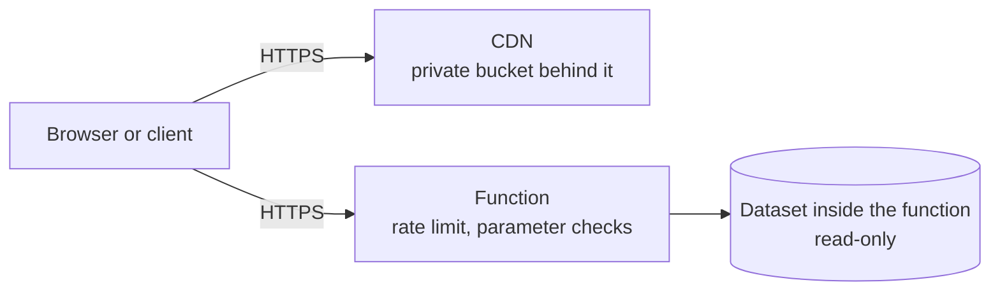

# Security

[Documentation index](../README.md)

Holiday Atlas is a public, read-only application with no accounts and no user data on the server. This page lists its security controls by category. It describes patterns and leaves out identifiers and policies.

## At a glance

| Topic | Summary |
|---|---|
| Exposure | Public read-only site and API. No sign-in, no user data stored on the server |
| Attack surface | A static site and one function. No database, no secrets in the function, no calls to other services at run time |
| Transport | HTTPS only, TLS 1.2 or later on the site |
| Abuse protection | Rate limit per client address, with a clear answer and a waiting time |
| Access control | A function role limited to logging, and a deploy identity limited to this project's resources |
| Input and output | Parameters checked before use, JSON errors that reveal no internal detail |
| Supply chain | Locked dependencies, container images scanned in the registry, no third-party script at run time |
| Cost | Monthly budget with email alerts |

## Controls along a request

## Controls by category

### Small attack surface

- The site is a static export. No server-side code runs when a page is requested.
- The API is one function with two REST routes and one MCP endpoint, all read-only.
- The dataset ships inside the function. There is no database to reach and no query to inject into.
- The function calls no other service, holds no secret and has no environment configuration.

### Transport

- The site is served over HTTPS, and HTTP is redirected.
- The distribution accepts TLS 1.2 or later and serves HTTP/3.
- The API address accepts HTTPS only.

### Abuse protection

- Requests are rate limited per client address. A client over the limit receives `429` with a `Retry-After` header.
- The web app reads that header and tells the visitor how long to wait.
- The function has a short time limit and a small memory size, which bound the cost of any single request.

### Input validation and errors

- The year must be an integer inside the served window. Anything else returns `400`.
- A country code is looked up in the dataset. An unknown code returns `404`.
- An unexpected failure on a REST route returns a generic message. Internal error text is not sent to the caller.

### Cross-origin access

The API is public and carries no credentials, so it allows calls from any origin for the methods it serves. The rule is defined in one place.

### Identity and access

- The function's role allows it to write logs and nothing else.
- Deploys use a separate identity that can only upload to this project's bucket, invalidate its distribution, push to its image registry and update its function.
- Infrastructure changes are applied with different credentials from the deploy identity.
- The frontend workflow runs with read-only repository permissions.

### Data protection

- The server stores no user data. Language and theme choices stay in the browser.
- The site bucket blocks public access and is read only through the CDN.
- The page makes no request to a third party at run time: fonts and the API reference assets are hosted with the site.
- Links that open a new tab do not give the new page access to the opener.

### Supply chain

- Installs in continuous integration use the lock file exactly.
- The image registry scans each image when it is pushed.
- The function image starts from the base image AWS publishes for Lambda.
- The Terraform provider version is pinned by a committed lock file.

### Recovery and cost

- The code and the dataset are in version control, and the registry keeps recent images, so an earlier version can be redeployed.
- A monthly budget sends email alerts before and when the limit is reached.

## What this page leaves out

Resource names and identifiers, access policies, alert thresholds and operating procedures stay in the private repositories.
