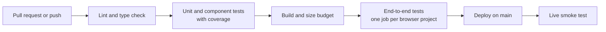

# Testing

[Documentation index](../README.md)

The frontend has unit tests, component tests and an end-to-end suite that runs on four browser projects in continuous integration. The backend is checked by a sanity check script, and a test suite for it is planned.

## At a glance

| Topic | Summary |
|---|---|
| Unit and component tests | Vitest, React Testing Library and jsdom: 137 tests in 16 files |
| End-to-end tests | Playwright on Chromium, Firefox, WebKit and a phone viewport |
| Accessibility tests | axe-core scans inside the end-to-end suite, WCAG 2.1 A and AA |
| Coverage gate | 90% of lines on pure logic, hooks and the globe's geometry modules |
| Performance gate | First-load JavaScript size budget |
| Live tests | A short suite against the deployed site and the real API |
| Automation | GitHub Actions on every pull request and every push to the main branch |

## Where each test runs

## Frontend results

From the continuous integration run on the main branch on 2026-10-12.

| Check | Result |
|---|---|
| Lint, types, unit tests, build | Passed |
| Unit and component tests | 137 passed of 137, in 16 files |
| End-to-end, Chromium | 59 passed |
| End-to-end, Firefox | 58 passed |
| End-to-end, WebKit | 58 passed |
| End-to-end, phone viewport | 57 passed |
| First-load JavaScript | 205.2 kB gzip, under the 226 kB budget |

### Unit and component tests

Test files sit next to the code they test.

| Area | Test files | What they cover |
|---|---|---|
| Pure logic | 6 | API wrapper and error kinds, calendar builder, search, year window, country and holiday text |
| Hooks | 6 | The two API requests, calendar selection, language, theme, current date |
| Globe geometry | 2 | Projection, level of detail and flight path, and a check that the precomputed data matches the map data |
| Components | 2 | Calendar and country selector behaviour, tested through the rendered page |

The build fails when line coverage drops below 90% on the pure logic, the hooks or the globe's geometry modules. Components have behaviour tests and no numeric threshold. Coverage over every file, including the canvas drawing code, was 57.6% of lines on 2026-10-12.

### End-to-end tests

The suite runs against the static files the build produced, with API responses replayed from recorded fixtures. Each browser project runs as its own job.

| Suite | Scope |
|---|---|
| Home | First load, language toggle, theme toggle, system theme on a first visit, MCP command copy, link to the API reference |
| Country | Search by name and by code, no match, keyboard selection with arrows, Enter and Escape, selection panel, reset, list of countries and their counts |
| Calendar | Header, regional note, year selector and its limits, year change without layout movement, month and holiday details, keyboard steps |
| Errors | Server error and retry, empty list, not found, rate limited with and without a readable waiting time, country without holidays |
| Static pages | The API reference page and the not-found page |
| Accessibility | An axe-core scan of five screen states in both themes. A state must report zero violations |

### Live tests

Two tests run against the deployed site after each deploy. One loads the site, selects a country and checks a known holiday. The other checks that the real API still answers in the format the fixtures were recorded in.

## Backend checks

Measured on 2026-10-12.

| Check | Result |
|---|---|
| TypeScript strict check | Passes |
| Sanity check script | All checks passed |

The sanity check verifies the shape of the dataset and compares resolved dates with known ones for a reference year: Easter, Eid al-Fitr, Rosh Hashanah, Chinese New Year, Labor Day and Thanksgiving in the United States. It checks that Hijri dates are marked as estimated, that an unknown country code is refused, and that all 210 countries resolve without error.

## Status by repository

Measured on 2026-10-12.

| Repository | Unit tests | End-to-end tests | Lint | Type check | Continuous integration |
|---|---|---|---|---|---|
| `frontend` | 137 tests, coverage gate at 90% on logic | Four browser projects, with accessibility scans | Passes | Passes, strict mode | GitHub Actions on pull requests and pushes |
| `backend` | Planned. A sanity check script runs today | Planned | Planned | Passes, strict mode | Planned |
| `infrastructure` | Not applicable | Not applicable | Planned | Not applicable | Planned |

## Status and gaps

- The backend has no test framework yet. Its rule engine is made of pure functions, so it can be unit tested without AWS.
- The live smoke test runs after an automated deploy. The first automated deploy is pending, so it has not run in the pipeline yet.
